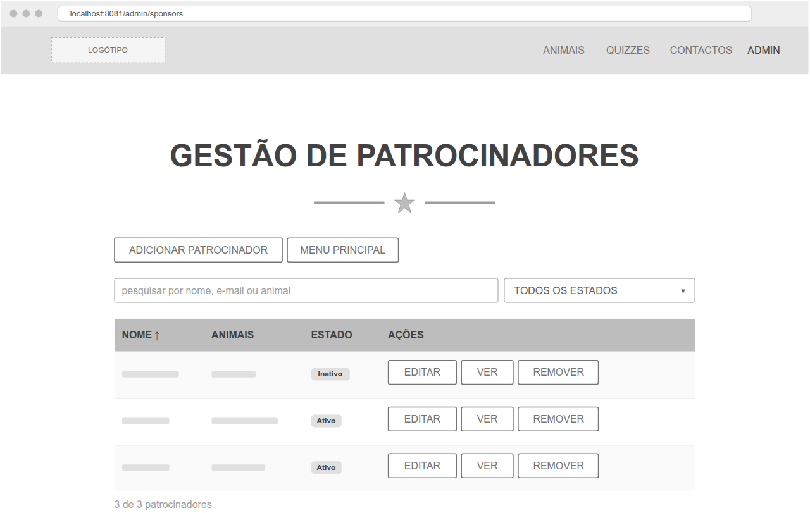
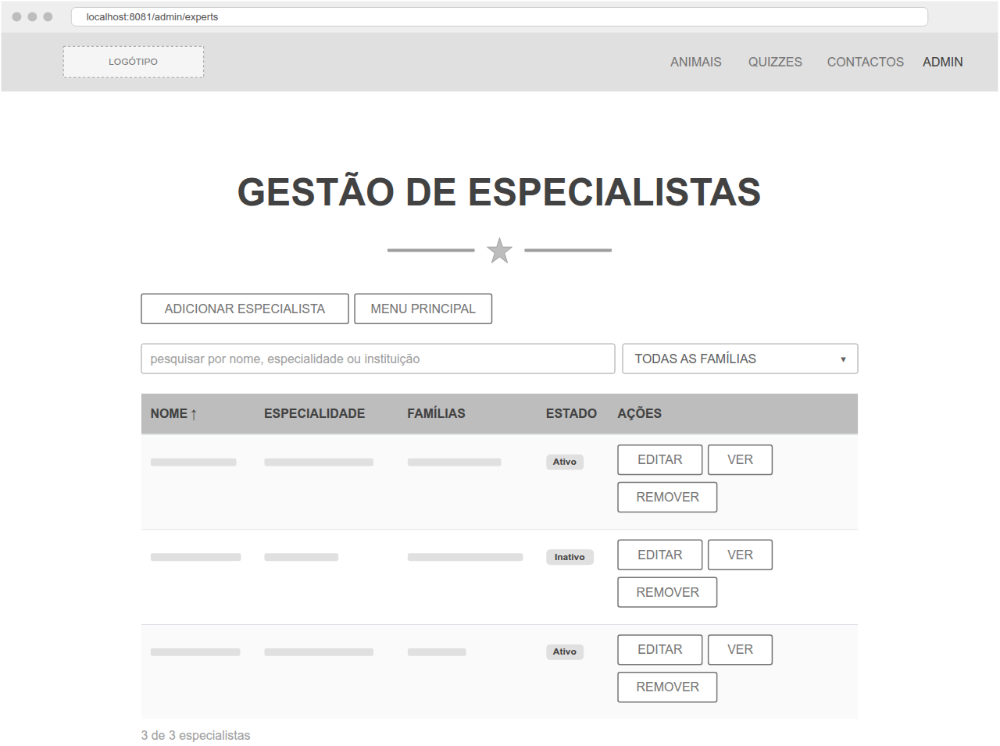
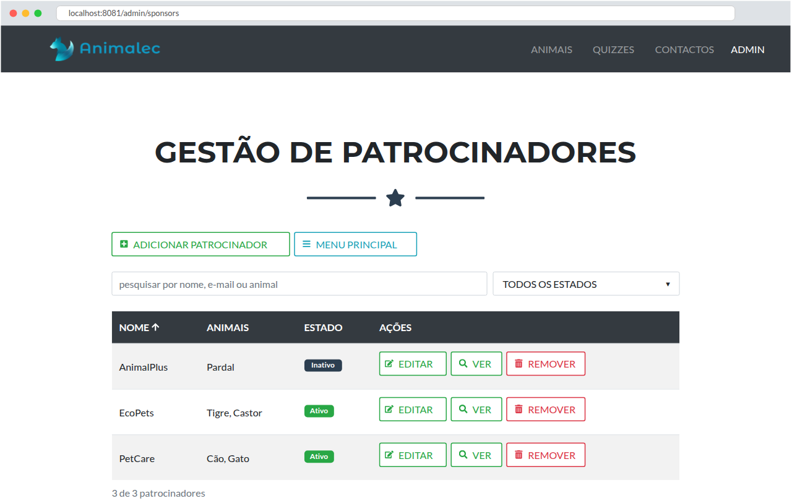
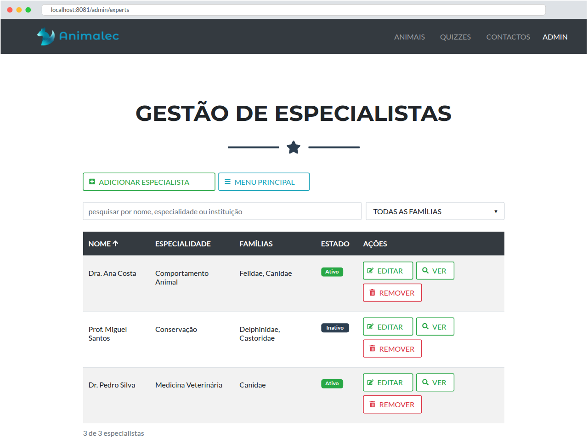

# Design — Patrocinadores e Especialistas no back-office do Animalec

Wireframes e mockups das duas entidades novas da Tarefa 3.1b, feitos a partir do protótipo funcional em `Front-end_Animalec-master/`. Cada ecrã existe em versão browser (1280 px) e mobile (390 px).

| Nível | Ficheiro | O que mostra | O que deixa de fora |
|---|---|---|---|
| Wireframe | `wireframes/animalec_wireframes.drawio` | Estrutura e hierarquia: zonas da página, navegação, campos, botões de ação | Cores, ícones, imagens e conteúdos reais (substituídos por caixas com X e barras cinzentas) |
| Mockup | `mockups/animalec_mockups.drawio` | Aspeto final: cores e tipos de letra do tema Animalec, ícones, estados Ativo/Inativo, dados de exemplo | Comportamento: nada é clicável |
| Protótipo | `../Front-end_Animalec-master/` | Navegação, formulários, validação, pesquisa, filtros, ordenação, confirmações | Servidor real (os dados ficam no navegador) |

## Ecrãs

Cada ficheiro draw.io tem 10 páginas: os 5 ecrãs abaixo, em browser e mobile.

| Ecrã | Rota no protótipo |
|---|---|
| Painel de administração, com os seis cartões | `/admin` |
| Patrocinadores · listagem (pesquisa, filtro por estado, ordenação por nome) | `/admin/sponsors` |
| Patrocinadores · formulário (o de edição é igual, com os dados preenchidos) | `/admin/sponsors/add` |
| Especialistas · listagem (pesquisa, filtro por família, ordenação por nome) | `/admin/experts` |
| Especialistas · formulário (o de edição é igual, com os dados preenchidos) | `/admin/experts/add` |

As imagens em `wireframes/` e `mockups/` mostram as duas listagens (browser e mobile) sem ser preciso abrir o draw.io.

| | Patrocinadores | Especialistas |
|---|---|---|
| Wireframe |  |  |
| Mockup |  |  |

## Informação de cada entidade

- **Patrocinador** (empresa ou instituição que se identifica com animais): nome, e-mail, website, logótipo (opcional), descrição, animais patrocinados, estado (ativo/inativo).
- **Especialista** (cientista de uma espécie ou família de animais): título, nome, e-mail, especialidade, instituição, nota biográfica, famílias de animais (pelo menos uma), estado (ativo/inativo).

Os ficheiros `.drawio` abrem e editam-se em [draw.io / diagrams.net](https://app.diagrams.net).
